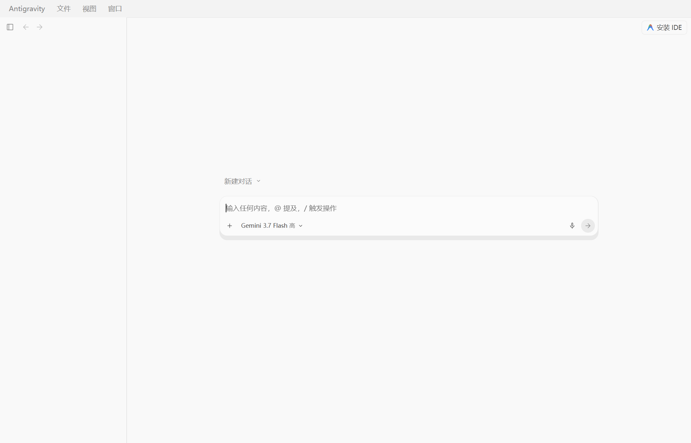

# Antigravity 2.0 汉化

给 [Antigravity](https://antigravity.google/) 2.0 的界面加中文。

当前适配 **2.29.0**：新增 600 条界面文案，覆盖内置浏览器、语音、侧边面板、远程项目、插件登录和自动化任务；词典共 3495 条。已在 Windows 版 2.29.0 验证运行时注入，macOS 本轮未实机验证。

不改安装目录里的任何文件：以调试端口启动 Antigravity，通过 Chrome DevTools 协议把翻译脚本注入页面。想恢复英文，关掉再正常启动就行；官方更新也不会弄坏它。



  

## 用法

前置：Windows 或 macOS、Antigravity 2.0、Python 3.10+ 和 websockets（推荐 Python 3.11+，离线测试要求 3.11+）。

```bash
pip install websockets
```

Windows 双击 `qidong.bat`，macOS 双击 `qidong_mac.command` 或在终端跑 `./qidong_mac.sh`：自动发现并复用已有的 Antigravity 调试端口；只有应用未运行时才启动。等待界面加载完注入，再守护 30 秒防止页面重载把脚本冲掉。看到 `[2/2] Done!` 就完成了；失败时启动器会保留错误退出码。

**默认不会关闭或重启应用。** 已运行但没有可用调试端口时，会报错并保持应用不变。保存工作后可运行 `python hanhua_v2.py --force-restart`，输入 `RESTART` 确认后才关闭并重启；这仍可能丢失未保存内容。仅在明确接受风险的非交互场景使用 `--force-restart --yes`。

macOS 从 GitHub 下 ZIP 解压的话，双击 `.command` 可能被系统拦（文件带隔离属性），改在终端里跑 `./qidong_mac.sh` 就行；git clone 下来的不受影响。

也可以命令行：

```bash
python hanhua_v2.py                                # 自动发现并复用；未运行时启动并注入
python hanhua_v2.py --install-dir "D:\Antigravity" # 找不到可执行文件时手动指定（macOS 可指向 .app）
python hanhua_v2.py --port 9334                    # 只连接此端口；首次启动也使用此端口
python hanhua_v2.py --no-launch                    # 只注入已带调试端口的实例
python hanhua_v2.py --watch 60                     # 守护秒数，0 为不守护，默认 30
python hanhua_v2.py --force-restart                # 保存工作后，交互确认重启
```

省略 `--port` 时仅检查 Antigravity 进程拥有的回环监听端口，并校验调试服务的产品身份；首次启动仍默认使用 9333。发现多个有效调试端口时，需用 `--port` 明确选择，不会随意选一个实例。

注入只存在于内存里，每次启动 Antigravity 都要重跑。偶尔注入成功了界面还是英文，多半是页面后来又重载过：等守护期结束，或界面稳定后跑一次 `python hanhua_v2.py --no-launch`。

也可以开启安全自动注入（仅 Windows；需要应用已有调试端口）：

```bash
python hanhua_v2.py --autostart on      # 开启（建登录自启项，下次登录生效）
python shouhu.py --verbose              # 或先前台跑一次看效果，Ctrl+C 退出
python hanhua_v2.py --autostart status  # 看状态
python hanhua_v2.py --autostart off     # 关闭
```

后台守护每轮结束后等待 2 秒：自动发现已验证的调试端口，引擎不在就补注入；没有端口或探测失败时只记录状态，不关闭、启动或重启 Antigravity。守护日志在同目录 `shouhu.log`。要立即注入，可直接运行启动器。

**从旧版守护升级**：正在运行的旧进程不会自动加载新代码。请先 `python hanhua_v2.py --autostart off`，再 `python hanhua_v2.py --autostart on`；下次登录生效，或手动运行 `python shouhu.py --verbose`。仅更新文件而不重启旧守护，旧版自动关闭应用的行为仍可能存在。

## 原理

`hanhua_v2.py` 复用现有实例，或在应用未运行时带调试端口启动。`cdp_discovery.py` 核实进程和本机监听端口，读取 `/json/version`、`/json`，等页面真正就绪后注入带字典的 MutationObserver 脚本。脚本监听 DOM 变化实时替换文案；代码块、终端、编辑器、输入框、会话列表都在禁区里，不会被翻译。约 0.6 MB 的内存增量是旧版较小词典的历史测量，当前版本待重新测量。

为什么不用老项目的办法：[cshitian/antigravity_chinese](https://github.com/cshitian/antigravity_chinese) 针对 1.x，往 `workbench.html` 写 `<script>` 并同步 `product.json` 校验值。2.0 把 `resources/app` 打包成了 `app.asar`，界面改由本地服务渲染，那个注入点不存在了，失败还是静默的（上游 Issue #4 提过，一直没人修）。

## 补充翻译

漏翻的地方只需要改 JSON，不用碰代码。

1. 把 Antigravity 导航到那个页面，运行 `python caiji.py`，未翻译的英文会写进 `pending.json`（采集器暂不自动发现端口；非 9333 时加 `--port <端口>`）
2. 翻译后按 `{"原文": "译文"}` 的格式加进 `dicts/`：`common.json` 放通用词，`ui_v2.json` 放 2.0 基础文案，`ui_v2_225.json` 和 `ui_v2_229.json` 分别放 2.25.25、2.29.0 的增量；同一个 key 别写进两个文件
3. `python hanhua_v2.py --no-launch` 重新注入验证

写字典有三条规矩：

1. 只写完整的 UI 字符串。30 字符以上的词条会参与子串替换，写半截短语会把整句搅成中英混杂。
2. 不翻用户内容和产品名。会话标题、路径、邮箱保持原样；Antigravity、Gemini 这类产品名也不动。
3. 带变量的句子（比如「当前模型：<模型名>」）走 `hanhua_v2.py` 的 `REGEX_RULES`，写死进字典的话官方一换内容就失效。

Agent 统一译作智能体。下拉菜单和悬停提示只在展开或悬停时才进 DOM，采集时记得保持那个状态；官方大改界面后，部分词条可能要重新采集。

官方更新后想知道哪些词条失效了：跑 `python caiji.py --misses`，它会列出注入以来界面上出现过但没翻出来的英文，写入 `misses.json`（同样可能含本机数据，勿提交）。

`caiji.py` 只覆盖你点到的那几页。想审计整个界面（包括未打开的设置页），先从调试端口的 `/json` 取得主页面 URL，再从该 URL 的 origin 下载 `/main.js`（2.29.0 约 11 MB；界面服务端口与调试端口不同，可能使用自签名 HTTPS）。抽取 UI 字符串与 `dicts/` 做双向 diff，可发现新增或改写的原文；核对上下文并排除库文案及用户数据后再翻译。过滤规则与踩坑见 [CLAUDE.md](CLAUDE.md) 的「bundle 审计法」。

离线回归检查：`python -m unittest discover -s tests -v`（需本机有 Node.js，不会启动或修改 Antigravity）。改完词典或引擎都运行一次。

`pending.json` 是你本机的界面快照，可能夹带账号邮箱，已在 `.gitignore` 里，别提交。

## 限制

- Windows / macOS（Linux 未测；自动注入仅 Windows）
- 只注入主界面窗口；开多个窗口时其余的不翻
- 不开自动注入时，每次启动都要手动重跑脚本
- 需要能开 DevTools 调试端口，部分企业安全策略会拦截
- 调试端口在 Antigravity 运行期间一直开放，本机任何进程都能借它读到页面内容（包括代码和会话）。脚本注入完会断开，但端口随进程存活，介意就用完关掉、不带端口重启（界面会回到英文）

## 项目结构

```
hanhua_v2.py         主脚本：加载字典、生成引擎、启动、注入、守护
cdp_discovery.py     进程/监听端口归属校验、实例发现与确认后的定向关闭
caiji.py             采集当前页面未翻译的英文
shouhu.py            可选守护进程（仅 Windows）：登录自启，自动检测启动并注入
qidong.bat           Windows 一键启动器
qidong_mac.sh        macOS 一键启动器
qidong_mac.command   macOS 双击入口（调 qidong_mac.sh）
dicts/               字典（common.json + ui_v2*.json，约 3500 条）
tests/               离线词典及完整 JavaScript 引擎回归测试
TODO.md              按顺序推进的优化清单及验证记录
```

实现细节和踩坑记录在 [CLAUDE.md](CLAUDE.md)。

## 致谢

衍生自 [cshitian/antigravity_chinese](https://github.com/cshitian/antigravity_chinese)（Antigravity 1.x 汉化）。文本归一化、字典加载逻辑和 MutationObserver 引擎骨架沿用自它，约 110 条词条在它基础上修订；CDP 注入机制和 2.0 的界面字典是新写的。

> 原项目未附带开源许可证。原作者若对沿用有异议，欢迎提 Issue 协商。

## 许可证

[MIT](LICENSE)。

## 讨论

在 [LINUX DO](https://linux.do) 社区发布与讨论，欢迎来帖子里反馈漏翻词条。
