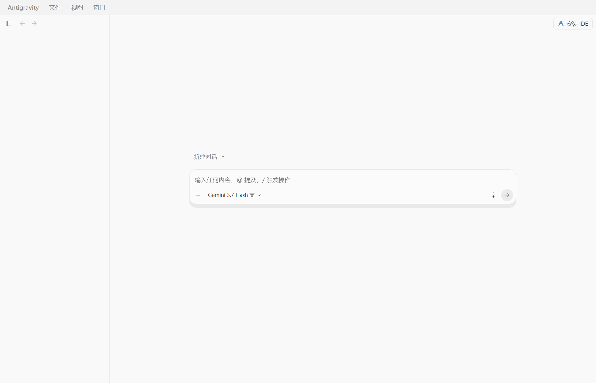

# Antigravity 2.0 汉化

给 [Antigravity](https://antigravity.google/) 2.0 的界面加中文。

不改安装目录里的任何文件：以调试端口启动 Antigravity，通过 Chrome DevTools 协议把翻译脚本注入页面。想恢复英文，关掉再正常启动就行；官方更新也不会弄坏它。



  

## 用法

前置：Windows、Antigravity 2.0、Python 3 和 websockets。

```bash
pip install websockets
```

最省事的方式是双击 `qidong.bat`：关掉正在运行的 Antigravity（未保存的编辑会丢），带调试端口重启，等界面加载完注入，再守护 30 秒防止页面重载把脚本冲掉。看到 `[3/3] Done!` 就完成了。

也可以命令行：

```bash
python hanhua_v2.py                                # 自动探测安装路径 + 启动 + 注入
python hanhua_v2.py --install-dir "D:\Antigravity" # 找不到 Antigravity.exe 时手动指定
python hanhua_v2.py --port 9334                    # 默认端口 9333 被占用时
python hanhua_v2.py --no-launch                    # 只注入已带调试端口的实例
python hanhua_v2.py --watch 60                     # 守护秒数，0 为不守护，默认 30
```

注入只存在于内存里，每次启动 Antigravity 都要重跑。偶尔注入成功了界面还是英文，多半是页面后来又重载过：等守护期结束，或界面稳定后跑一次 `python hanhua_v2.py --no-launch`。

## 原理

`hanhua_v2.py` 带着调试端口启动 Antigravity，轮询 `http://127.0.0.1:9333/json` 找到主界面页，等页面真正就绪后注入一段带字典的 MutationObserver 脚本。脚本监听 DOM 变化实时替换文案；代码块、终端、编辑器、输入框、会话列表都在禁区里，不会被翻译。实测内存增加约 0.6 MB。

为什么不用老项目的办法：[cshitian/antigravity_chinese](https://github.com/cshitian/antigravity_chinese) 针对 1.x，往 `workbench.html` 写 `<script>` 并同步 `product.json` 校验值。2.0 把 `resources/app` 打包成了 `app.asar`，界面改由本地服务渲染，那个注入点不存在了，失败还是静默的（上游 Issue #4 提过，一直没人修）。

## 补充翻译

漏翻的地方只需要改 JSON，不用碰代码。

1. 把 Antigravity 导航到那个页面，运行 `python caiji.py`，未翻译的英文会写进 `pending.json`
2. 翻译后按 `{"原文": "译文"}` 的格式加进 `dicts/`：`common.json` 放通用词，`ui_v2.json` 放 2.0 界面文案；同一个 key 别写进两个文件
3. `python hanhua_v2.py --no-launch` 重新注入验证

写字典有三条规矩：

1. 只写完整的 UI 字符串。30 字符以上的词条会参与子串替换，写半截短语会把整句搅成中英混杂。
2. 不翻用户内容和产品名。会话标题、路径、邮箱保持原样；Antigravity、Gemini 这类产品名也不动。
3. 带变量的句子（比如「当前模型：<模型名>」）走 `hanhua_v2.py` 的 `REGEX_RULES`，写死进字典的话官方一换内容就失效。

Agent 统一译作智能体。下拉菜单和悬停提示只在展开或悬停时才进 DOM，采集时记得保持那个状态；官方大改界面后，部分词条可能要重新采集。

`pending.json` 是你本机的界面快照，可能夹带账号邮箱，已在 `.gitignore` 里，别提交。

## 限制

- 仅 Windows
- 只注入主界面窗口；开多个窗口时其余的不翻
- 每次启动都要重新注入
- 需要能开 DevTools 调试端口，部分企业安全策略会拦截
- 调试端口在 Antigravity 运行期间一直开放，本机任何进程都能借它读到页面内容（包括代码和会话）。脚本注入完会断开，但端口随进程存活，介意就用完关掉、不带端口重启（界面会回到英文）

## 项目结构

```
hanhua_v2.py     主脚本：加载字典、生成引擎、启动、注入、守护
caiji.py         采集当前页面未翻译的英文
qidong.bat       Windows 一键启动器
dicts/           字典（common.json + ui_v2.json，约 1100 条）
```

实现细节和踩坑记录在 [CLAUDE.md](CLAUDE.md)。

## 致谢

衍生自 [cshitian/antigravity_chinese](https://github.com/cshitian/antigravity_chinese)（Antigravity 1.x 汉化）。文本归一化、字典加载逻辑和 MutationObserver 引擎骨架沿用自它，约 110 条词条在它基础上修订；CDP 注入机制和 2.0 的界面字典是新写的。

> 原项目未附带开源许可证。原作者若对沿用有异议，欢迎提 Issue 协商。

## 许可证

[MIT](LICENSE)。
